### Hi there 👋

I build bots, web panels and automation for online communities, with a background in moderation and Trust & Safety.

#### When I code, I rely on

  
  
  
  
  
  
  
  
  
  
  

#### What I build

  
<strong>Protection bots</strong> · <code>discord.js · Node.js</code>

  Bots that detect scam links, spam waves and hacked accounts and stop them automatically.

  
<strong>Team panels</strong> · <code>Express · PostgreSQL</code>

  Web panels with Discord login for moderation teams: reports, case files, logs and settings.

  
<strong>Server operations</strong> · <code>Linux · nginx · Cloudflare</code>

  Own servers with monitoring, encrypted backups and automated deploys.

#### Background

Trust & Safety · Community moderation · Customer support

#### My GitHub contributions summary

Most of my work lives in private repositories.
